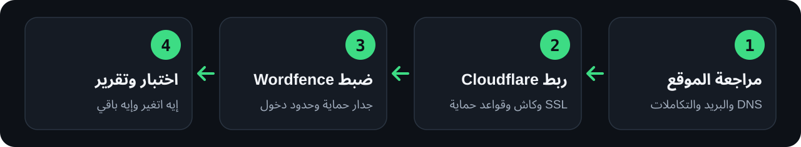
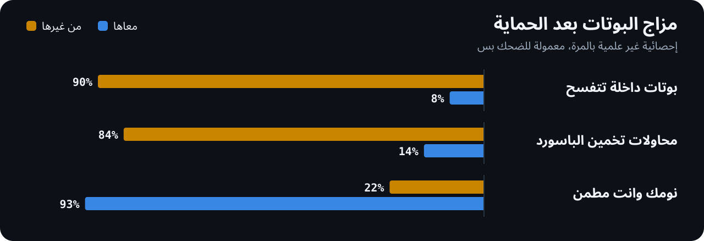

<p align="center"><a href="README.md">English</a> · <b>العربية</b></p>

<p align="center"></p>

> **موقعك يتقفل على البوتات، مش على عملائك.** تربط موقع WordPress بـ Cloudflare المجاني وتأمّنه بـ Wordfence بنفس الخطوات كل مرة: مراجعة DNS وSSL والكاش وقواعد الحماية وحدود الطلبات، ومراجعة الهجمات وحظر الأنماط المتكررة.

## بتشتغل إزاي؟

<p align="center"></p>

## قولها كده وسيبها تشتغل

- «اربط الموقع بكلاودفلير»
- «ظبط ووردفينس على الموقع ده»
- «راجع الاتاكس واحظر المتكرر»

## النتايج (بهزر، بس بجد مفيدة)

<p align="center"></p>

## ركّبها في دقيقة

| بتستخدم إيه؟ | الطريقة |
|---|---|
| حساب Claude أو ChatGPT | نزّل [`wordpress-cloudflare-wordfence.zip`](https://github.com/Marsadgrouplabs/wordpress-cloudflare-wordfence/releases/latest/download/wordpress-cloudflare-wordfence.zip) وارفعه من قسم Skills |
| Claude Code | `claude plugin marketplace add Marsadgrouplabs/wordpress-cloudflare-wordfence` |
| Claude Code أو Codex بسكربت | حمّل الـ repo وشغّل `install.ps1` أو `install.sh` |

<details>
<summary><b>الخطوات بالتفصيل</b></summary>

### حساب Claude أو ChatGPT

1. نزّل [`wordpress-cloudflare-wordfence.zip`](https://github.com/Marsadgrouplabs/wordpress-cloudflare-wordfence/releases/latest/download/wordpress-cloudflare-wordfence.zip) وماتفكّهوش.
2. **Claude:** افتح قسم Skills في حسابك واختار رفع ملف.
3. **ChatGPT:** افتح Skills، ثم Create، ثم Upload from your computer. الميزة متاحة حسب خطة الحساب.

### Claude Code كـ Plugin

```bash
claude plugin marketplace add Marsadgrouplabs/wordpress-cloudflare-wordfence
claude plugin install wordpress-cloudflare-wordfence@marsad-wordpress-cloudflare-wordfence
```

### ويندوز

```powershell
git clone https://github.com/Marsadgrouplabs/wordpress-cloudflare-wordfence.git
cd wordpress-cloudflare-wordfence
powershell -ExecutionPolicy Bypass -File .\install.ps1
```

### ماك أو لينكس

```bash
git clone https://github.com/Marsadgrouplabs/wordpress-cloudflare-wordfence.git
cd wordpress-cloudflare-wordfence
bash install.sh
```

السكربت بيركّبها لـ Claude Code في `~/.claude/skills` ولـ Codex في `~/.agents/skills`، ولو فيه نسخة قديمة بيحتفظ بيها.

</details>

## مطمنك: مين الناشر وبياناتك فين؟

الناشر هو **[Marsad Labs](https://labs.marsadgroup.co)**. Marsad Labs هي ذراع المنتجات في Marsad Group، شركة تسويق مسجلة في بريطانيا، وبتبني أدوات عملية للمسوقين والمطورين. [اعرف أكتر عننا](https://labs.marsadgroup.co/about-us/) · [سياسة الخصوصية](https://labs.marsadgroup.co/privacy-policy/)

| السؤال | الإجابة |
|---|---|
| **بتقرا إيه؟** | إعدادات الموقع اللي بتديها صلاحية توصلها. |
| **بتغيّر إيه لوحدها؟** | بتسألك قبل تغيير Nameservers وSSL Strict وأي إعداد ممكن يقفل عليك الموقع وقبل حذف ملفات من السيرفر. |
| **كلمات السر** | الـ skill ممنوعة تكتب كلمات السر، وانت اللي بتدخلها بنفسك. |
| **الكود** | تعليمات ومراجع نصية بس، ومفيهاش أي سكربتات بتشتغل على جهازك. |

النسخة دي اتفحصت بأداة SkillSpector، واتراجعت تنبيهاتها الحرجة والعالية يدوياً، واتشال منها أي بيانات عملاء أو مفاتيح. النتيجة الكاملة وطريقة التأكد من الملف والإبلاغ عن مشكلة في [`SECURITY.ar.md`](SECURITY.ar.md).

## محتاج إيه؟

- صلاحية دخول على حساب Cloudflare ولوحة تحكم WordPress.

## قبل ما تبدأ

- اتشالت من الملفات أسماء العملاء والدومينات وعناوين IP الحقيقية، واتبدلت بأمثلة عامة.

## الحقوق

كل الحقوق محفوظة لـ Marsad Labs. ممنوع النسخ أو إعادة النشر بدون إذن.

---

<p align="center">معمولة بحب وشاي كتير في <a href="https://labs.marsadgroup.co"><b>Marsad Labs</b></a></p>
