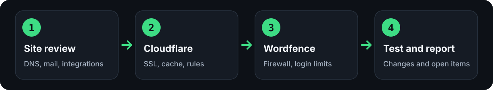
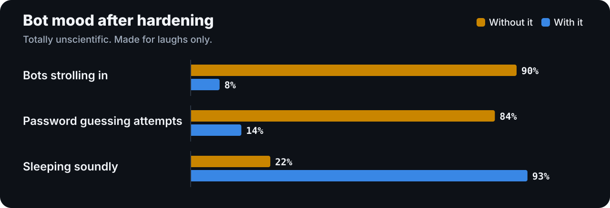

<p align="center"><b>English</b> · <a href="README.ar.md">العربية</a></p>

<p align="center"></p>

> **Lock out the bots, not your customers.** Connects a WordPress site to Cloudflare Free and hardens it with Wordfence, using the same steps every time: DNS, SSL, cache, security rules and rate limits, plus attack reviews and blocking of repeating patterns.

## How it works

<p align="center"></p>

## Just say it

- "Connect this site to Cloudflare"
- "Set up Wordfence on this site"
- "Review the attacks and block the repeat offenders"

## The results (joking, but also not really)

<p align="center"></p>

## Install in a minute

| You use | How to install |
|---|---|
| A Claude or ChatGPT account | Download [`wordpress-cloudflare-wordfence.zip`](https://github.com/Marsadgrouplabs/wordpress-cloudflare-wordfence/releases/latest/download/wordpress-cloudflare-wordfence.zip) and upload it under Skills |
| Claude Code | `claude plugin marketplace add Marsadgrouplabs/wordpress-cloudflare-wordfence` |
| Claude Code or Codex with a script | Clone the repo and run `install.ps1` or `install.sh` |

<details>
<summary><b>Step-by-step instructions</b></summary>

### Claude or ChatGPT account

1. Download [`wordpress-cloudflare-wordfence.zip`](https://github.com/Marsadgrouplabs/wordpress-cloudflare-wordfence/releases/latest/download/wordpress-cloudflare-wordfence.zip) and keep it zipped.
2. **Claude:** open Skills in your account and choose to upload a file.
3. **ChatGPT:** open Skills, then Create, then Upload from your computer. Availability depends on your plan.

### Claude Code plugin

```bash
claude plugin marketplace add Marsadgrouplabs/wordpress-cloudflare-wordfence
claude plugin install wordpress-cloudflare-wordfence@marsad-wordpress-cloudflare-wordfence
```

### Windows

```powershell
git clone https://github.com/Marsadgrouplabs/wordpress-cloudflare-wordfence.git
cd wordpress-cloudflare-wordfence
powershell -ExecutionPolicy Bypass -File .\install.ps1
```

### macOS or Linux

```bash
git clone https://github.com/Marsadgrouplabs/wordpress-cloudflare-wordfence.git
cd wordpress-cloudflare-wordfence
bash install.sh
```

The script installs to `~/.claude/skills` for Claude Code and `~/.agents/skills` for Codex, and keeps a backup of any older copy.

</details>

## Who publishes this, and where does your data go?

Published by **[Marsad Labs](https://labs.marsadgroup.co)**. Marsad Labs is the product arm of Marsad Group, a UK-registered marketing agency, and builds practical tools for marketers and developers. [About us](https://labs.marsadgroup.co/about-us/) · [Privacy policy](https://labs.marsadgroup.co/privacy-policy/)

| Question | Answer |
|---|---|
| **What does it read?** | The site settings you give it access to. |
| **What does it change on its own?** | It asks before changing nameservers, SSL Strict or any setting that could lock you out of the site, and before deleting server files. |
| **Passwords** | The skill is not allowed to type passwords. You enter them yourself. |
| **Code** | Text instructions and references only, with no scripts that run on your machine. |

This version was scanned with SkillSpector, its critical and high alerts were reviewed by hand, and client data and keys were removed. The full result, how to verify the file and how to report a problem are in [`SECURITY.md`](SECURITY.md).

## What you need

- Access to the Cloudflare account and the WordPress dashboard.

## Before you start

- Client names, domains and real IP addresses were removed from the files and replaced with generic examples.

## Rights

All rights reserved by Marsad Labs. Copying or redistribution without permission is not allowed.

---

<p align="center">Made with love and far too much tea at <a href="https://labs.marsadgroup.co"><b>Marsad Labs</b></a></p>
